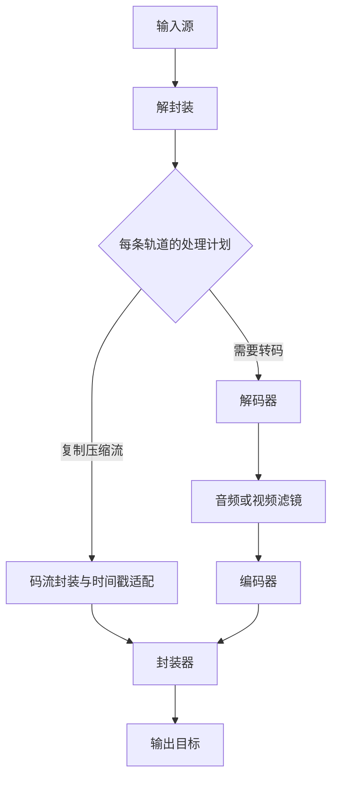

**建议采用：Rust 原生媒体核心 + 整条流水线规划器 + 共享缓冲区管理 + 稳定 C ABI 插件 + 按场景分发的能力包。**

这条路线能够实现你要求的动态加载，也有机会在常见任务上显著降低包体与内存，同时保持性能。实现重点应放在**减少不必要的处理、内存驻留和依赖**上；编解码器通过统一接口接入成熟实现，再逐步增加 Rust 原生实现。

我先明确两个设计前提：

- **“Rust 生态”允许插件内部调用系统 API、C/C++ 编解码库和汇编优化。** 核心框架、调度、资源管理、公开 Rust API 由 Rust 实现。如果要求所有编解码算法也必须纯 Rust，覆盖范围和性能需要重新限定。
- **“性能不能变差”以明确的任务、硬件和输出质量为验收条件。** 架构本身不能证明性能。FFmpeg 已支持按组件裁剪，也有 GPU 内解码、缩放、编码的完整路径，所以需要与**同功能、同后端、同质量设置的精简版 FFmpeg**比较。[GitHub](https://github.com/FFmpeg/FFmpeg/blob/master/configure?utm_source=chatgpt.com)

以下是我建议实际落地的架构。

---

## 一、先把“80% 场景”定义成可交付的任务集合

我会先按**桌面应用和常规文件处理**设计第一版，兼顾以后嵌入应用作为 SDK 使用。

### 首版任务范围

| 场景 | 首版能力 | 实现上的关键边界 |
|---|---|---|
| 媒体信息读取 | 容器、轨道、编码参数、时长、常见元数据 | 通常只需解析，不必启动解码器 |
| 转封装、提取音轨 | MP4/MOV、MKV/WebM、WAV、Ogg 等选定组合 | 按轨道复制压缩数据，必要时转换码流封装 |
| 视频转码 | 常见 H.264/HEVC 输入，H.264 输出；其他编码作为扩展包 | 必须按 profile、位深、平台逐项认证 |
| 调整视频 | 缩放、裁剪、旋转、帧率处理 | 优先覆盖常见 SDR、4:2:0；明确色彩处理语义 |
| 截图、缩略图 | 按时间提取帧、批量缩略图 | 需要正确 seek、解码预滚与输出时间判断 |
| 音频处理 | 解码、重采样、声道转换、音量、常用格式输出 | 解码和编码分别选择后端 |
| 剪切、拼接 | 关键帧对齐剪切、兼容流拼接；精确剪切走转码 | 明确快速剪切与精确剪切的区别 |

第一版可以暂缓专业广播格式、复杂字幕烧录、任意滤镜表达式、完整直播协议栈以及所有历史格式。HTTP、HLS、设备采集等可以通过独立能力包逐步加入。

**80% 应按用户任务的频率加权统计。**

例如，“MP4 输入”不是一个完整的支持项，真正的条目应类似：

> Windows / 有兼容硬件 / MP4 / H.264 High 8-bit / 1080p / 缩放并输出 H.264 + AAC。

覆盖率的分母要来自目标用户的任务样本；Windows 上的覆盖率也不能直接代表 Linux 无 GPU 环境的覆盖率。

---

## 二、总体架构：小核心，组件化数据处理

建议分成四个层次。

| 层次 | 主要职责 |
|---|---|
| **接口层** | CLI、Rust SDK、可选 C SDK；将请求转换为结构化任务 |
| **规划层** | 解析输入、选择组件、协商格式与设备、估算内存、生成执行计划 |
| **运行时层** | 调度、背压、共享缓冲区、时间线、取消、资源预算、指标 |
| **插件层** | 容器、编解码、码流处理、滤镜、硬件设备、网络与设备 I/O |

数据处理图应同时支持压缩数据直通和完整转码：



这里有三个值得从第一天坚持的设计决定。

**第一，按轨道规划。** 一个任务可以同时采用“视频转码、音频复制、字幕保留”，无需让所有轨道经过同一套处理。

**第二，压缩流复制是一等能力。** 转封装和部分剪切无需解码，可以直接减少计算与原始帧内存。不过，仍需正确处理 codec 初始化数据、码流格式、时间戳和容器约束。

**第三，核心只认识组件接口。** 它不应直接依赖 H.264、AV1、Metal、CUDA 或某个网络库。这样，音频工具、桌面应用和服务器转码服务可以复用同一内核，同时选择不同的组件集合。

---

## 三、数据模型：把时间、内存和设备信息放进基础类型

媒体框架最难后补的部分，是帧与缓冲区的表示方式。

建议建立以下核心对象：

| 对象 | 必须包含的信息 |
|---|---|
| `StreamConfig` | 编码 ID、profile、初始化数据、码流封装形式、配置版本 |
| `Packet` | 压缩数据引用、轨道 ID、PTS、DTS、duration、time base、关键帧标记、附加数据 |
| `VideoFrame` | 像素格式、编码与显示尺寸、各 plane 的 stride/offset、色彩信息、时间戳、缓冲区引用 |
| `AudioFrame` | 采样格式、采样率、声道布局、样本数、时间戳、缓冲区引用 |
| `BufferRef` | 内存域、所有者、引用生命周期、映射能力、实际分配大小 |
| `DeviceContext` | 设备身份、后端类型、资源共享能力、同步机制 |

### 1. 时间使用整数与有理数

采用：

> `timestamp: i64` + `time_base: Rational`

避免把时间统一转换为浮点秒再反复计算。还要明确表达“时间戳未知”，并保留 PTS 和 DTS 的区别。

音频剪切与拼接应按样本计算；视频需要保留可变帧率、帧持续时间与显示顺序。

### 2. 帧保留原生表示

视频可以是 YUV420P、NV12、P010，也可以是 GPU surface。音频可以保持整数或浮点、平面或交错布局。

只有下游组件确实需要其他格式时，规划器才插入转换节点。把所有视频先变成 RGBA、所有音频先变成同一种格式，会增加内存、带宽和计算。

### 3. `BufferRef` 必须覆盖 CPU 和 GPU

内部至少区分：

- CPU 普通内存与对齐内存。
- 系统或驱动分配的图像缓冲区。
- D3D texture。
- Apple `CVPixelBuffer`。
- CUDA、VA-API、Vulkan 等设备资源。

同样叫 NV12，资源也可能有不同的平铺布局、设备归属和共享方式。Linux 的 DMA-BUF 还需要 fourcc、modifier、stride、offset 等信息，部分缓冲区甚至不适合 CPU 映射。[gstreamer.freedesktop.org](https://gstreamer.freedesktop.org/documentation/additional/design/dmabuf.html?utm_source=chatgpt.com)

因此，**“零拷贝”要通过资源协商实现，不能仅靠 `Arc` 或一个统一帧结构实现。**

---

## 四、动态插件：内部用 Rust trait，跨动态库用 C ABI

这是整个方案的长期兼容边界。

Rust 官方明确说明，Rust ABI 不提供稳定性保证。因此，独立分发和升级的插件应使用：

> **`cdylib` + `extern "C"` + `#[repr(C)]` + 版本化函数表 + 不透明句柄。**

核心内部继续使用普通 Rust 类型和 trait，通过 SDK 包装 ABI。[The Rust Reference](https://doc.rust-lang.org/reference/items/external-blocks.html?utm_source=chatgpt.com)

### 4.1 插件种类

建议注册以下组件：

| 组件接口 | 职责 |
|---|---|
| `Source` / `Sink` | 本地文件、网络、内存、设备输入输出 |
| `Demuxer` / `Muxer` | 容器读取与写入 |
| `BitstreamProcessor` | 码流解析、初始化数据提取、封装形式转换 |
| `Decoder` / `Encoder` | 音视频编解码 |
| `VideoFilter` / `AudioFilter` | 缩放、转换、重采样等 |
| `DeviceProvider` | 设备发现、资源分配、共享与同步 |

**组件接口的粒度可以细，动态库的粒度应按共同依赖组织。**

例如一个 `backend-apple` 插件可以同时提供视频编解码、视频处理和设备资源支持；一个 AV1 包也可以提供多个实现。这样能减少重复依赖和初始化成本。

### 4.2 最小 ABI 形状

下面是接口形状示意：

```c
typedef struct {
    uint32_t struct_size;
    uint16_t abi_major;
    uint16_t abi_minor;
} MediaAbiHeader;

typedef struct MediaHostApiV1 MediaHostApiV1;
typedef struct MediaPluginApiV1 MediaPluginApiV1;

int32_t media_plugin_query_v1(
    const MediaHostApiV1 *host,
    MediaPluginApiV1 *out_api
);
```

`MediaPluginApiV1` 返回组件描述与工厂函数。每个可扩展结构携带 `struct_size`，新增可选字段只追加到尾部。

兼容规则应明确：

- ABI 主版本不匹配，拒绝加载。
- 次版本新增能力通过字段长度和 capability 检测。
- 插件限定目标平台、架构、系统 ABI 和最低 CPU 指令要求。
- 参数使用固定宽整数、字节视图、不透明指针和函数指针。
- `Vec`、`String`、`Arc`、trait object、closure、`Future` 等留在各自模块内部。

稳定 C ABI 解决的是**同一平台 ABI 下的独立编译兼容**，不是一个插件二进制跨所有系统运行。

### 4.3 编解码接口采用输入、输出分离

建议接口如下：

| 方法 | 作用 |
|---|---|
| `query_caps` | 查询支持的编码、profile、格式和内存域 |
| `query_requirements` | 查询最小缓冲、线程、设备和私有内存需求 |
| `create` / `configure` | 创建并配置实例 |
| `submit` | 提交一个输入 |
| `receive` | 取出一个输出或状态事件 |
| `drain` | 输入结束，输出内部剩余数据 |
| `reset` | seek、取消或流重启时丢弃旧状态 |
| `destroy` | 释放实例资源 |

不要设计为简单的 `decode(packet) -> frame`。实际编解码可能一个输入产生零个或多个输出，也可能先缓存多个输入。FFmpeg 的 send/receive 接口明确采用这种输入输出分离模型。[ffmpeg.org](https://ffmpeg.org/doxygen/trunk/group__lavc__encdec.html?utm_source=chatgpt.com)

状态至少区分：

- `ACCEPTED`：输入被接受。
- `WOULD_BLOCK`：输入未消费，需要推进其他工作。
- `NEED_INPUT`：需要更多输入。
- `PENDING`：异步硬件工作尚未完成，附带可等待事件。
- `FORMAT_CHANGED`：需要重新协商输出。
- `EOF` / `ERROR`。

`NEED_INPUT` 和 `PENDING` 的区别能避免调度器忙等。

### 4.4 所有权必须写进协议

我建议采用以下契约：

1. 调用方始终管理自己持有的输入引用；插件需要异步保留输入时显式增加引用。
2. `WOULD_BLOCK` 不消费输入。
3. `receive` 成功时向调用方交付一个拥有生命周期的输出引用。
4. 内存通过原分配方提供的回收回调释放，避免跨 allocator 释放。
5. 共享缓冲区默认只读，修改要求独占或显式复制。
6. 输出帧可以比 codec 实例活得更久，其所有者必须保住所需的 pool、设备和模块。
7. GPU 工作完成前，缓冲区不能回到可复用池。

跨 ABI 返回状态码和可复制的错误信息；panic 或外部异常必须在各自边界处理，不能穿过接口。

### 4.5 首版支持懒加载，暂缓运行中卸载代码

推荐流程：

> 读取插件 manifest → 筛选候选 → 加载选中模块 → 校验 ABI 与真实能力 → 创建实例。

任务结束就释放实例、线程和缓冲池。**首版让动态库代码保留到进程退出。**

如果以后支持卸载，必须确认所有实例、帧析构回调、插件线程、正在执行的函数及 GPU 工作均已结束。`libloading` 可以管理库与符号，但函数指针进入自定义函数表后，仍需框架自己维护模块生命周期。[Rust](https://docs.rs/libloading/latest/libloading/struct.Library.html?utm_source=chatgpt.com)

---

## 五、规划器：为整条路径选择后端

建议把规划器作为一个独立模块。这是实现资源优化的主要位置。

规划顺序可以是：

1. 探测容器和轨道。
2. 判断每条轨道需要复制、解析还是转码。
3. 从 manifest 筛选可能的组件。
4. 查询选中后端的实际能力。
5. 协商像素格式、内存域、设备和缓冲池。
6. 估算最小工作集及并行度。
7. 在质量、兼容性和资源约束内选择执行路径。

### 不能只逐个选择“最快组件”

假设：

- 解码器 A 输出 D3D11 texture。
- 滤镜 B 只接受 CPU RGBA。
- 编码器 C 接受 CUDA NV12。

即使各组件单独都很快，整条路径也可能因为回传、格式转换和再次上传而变慢。

所以选择目标应是：

> **满足输出要求与资源约束后，最小化端到端处理成本。**

成本至少包括：

- 编解码与滤镜计算。
- 内存拷贝与 CPU/GPU 传输。
- 格式转换。
- 设备初始化。
- 必需缓冲数量。
- 调度和同步。

短音频、低分辨率或几帧截图任务，也可能适合 CPU 路径。

### 让计划可解释

建议提供类似：

```text
media plan input.mp4 --output output.mp4 --explain
```

展示：

- 每条轨道是否转码。
- 实际使用的编解码实现。
- 数据在哪个内存域。
- 哪些位置发生转换或传输。
- 缓冲池和内存预算。
- 是否存在软件回退。

这些信息既服务用户排查，也能直接用于性能回归分析。

硬件失败时可以在**开始处理前**按配置选择其他后端。处理中途的设备丢失，则需要明确失败或从可恢复点重新启动；编码器切换可能改变参数和码流结构，不能无条件继续拼接输出。

---

## 六、内存优化：管理整条流水线的工作集

**只限制队列容量，无法控制整个媒体任务的内存。**

建议建立以下内存账本：

\[
M =
M_{\text{core}}
+ M_{\text{codec-private}}
+ M_{\text{unique-buffers}}
+ M_{\text{packet/index/mux}}
+ M_{\text{threads}}
+ M_{\text{device-context}}
\]

其中同一底层帧被多个组件引用，只计算一次实际分配。CPU 与设备内存分别报告；统一内存平台还要避免简单相加造成重复统计。

### 6.1 使用可协商的缓冲池

每个组件声明：

- 支持的 allocator 和内存域。
- 对齐、padding、stride 和格式限制。
- 最少需要保留的输入、输出及参考帧。
- 可接受的并行深度。
- 是否允许下游提供缓冲池。

硬件插件可以拥有自己的 allocator。核心负责统一生命周期与预算，而不是强制所有资源都由同一个 CPU allocator 分配。

这与 GStreamer 已验证的 allocation negotiation 思路一致：先协商媒体格式，再协商 allocator、buffer pool 和布局。[gstreamer.freedesktop.org](https://gstreamer.freedesktop.org/documentation/additional/design/bufferpool.html?utm_source=chatgpt.com)

### 6.2 减少多余原始帧驻留

以 3840 × 2160 的 8-bit YUV420 为例，忽略对齐时：

\[
3840 \times 2160 \times 1.5 \approx 11.87\ \text{MiB/帧}
\]

如果框架层的多余队列从 16 帧降到 4 帧，理论上减少约 **142 MiB** 的帧数据驻留。

这是尺寸计算示例，**不代表能削掉解码器必须保留的参考帧或编码前瞻**。P010 使用 16-bit 存储时，同尺寸约为 23.73 MiB/帧，队列管理会更加重要。

### 6.3 预算同时约束字节、数量和媒体时长

每条边建议同时设置：

- 字节上限。
- 帧或 packet 数量上限。
- 排队媒体时长上限。

固定“最多 8 帧”无法覆盖不同分辨率和位深的内存差异；只按字节限制，也可能导致某条低码率轨道积累很长的延迟。

调度器应优先消费和释放下游资源，再允许上游继续产生数据。离线转码通过背压控制，保持输出完整。

### 6.4 最小工作集必须先预留

解码参考帧、编码 lookahead、硬件 surface pool 都可能是正常运行所必需的。预算低于最小工作集时，应在预执行阶段拒绝，或采用用户已允许的其他计划。

不能先启动所有节点，再让它们互相等待无法获得的缓冲区。

NVIDIA 官方文档也明确指出：减少 surface 数量可能降低吞吐，需要寻找内存与性能的平衡。[docs.nvidia.com](https://docs.nvidia.com/video-technologies/video-codec-sdk/13.0/nvdec-video-decoder-api-prog-guide/index.html?utm_source=chatgpt.com)

因此，在你的要求下，优化对象主要是：

> **多余的驻留、重复分配、重复转换，以及未协调的并行度。**

改变参考帧、编码前瞻、分辨率等输出相关配置，必须作为不同产品模式单独评价。

### 6.5 对不透明内存保持诚实

框架能够严格限制自身管理的分配，但外部编解码器、系统驱动未必允许精确控制全部私有内存。

插件应报告：

- 可精确管理的内存。
- 可估算的私有工作集。
- 当前无法归因的外部开销。

因此，`memory_budget` 应先定义为**受框架管理资源的预算与任务准入条件**。要承诺整个进程绝不超过某个数值，还需要后端支持和系统级控制。

---

## 七、调度模型：下游驱动 + 有界队列 + 全局并行预算

我建议采用混合调度：

- 用下游需求和可用资源决定是否继续生产。
- 用有界队列连接必须并行的阶段。
- 用事件通知推进异步硬件。
- 将轻量、兼容的处理步骤放在同一执行任务中。

避免默认给每个节点都分配独立线程池。

### 统一管理线程预算

一次任务可能同时包含：

- 解码器内部线程。
- 编码器内部线程。
- CPU 滤镜线程。
- I/O 工作线程。
- GPU 提交与完成处理。

这些需要共享一个任务级预算。否则每个库各自按 CPU 核数开线程，很容易增加栈内存、竞争与调度开销。

本地文件处理可以使用同步 I/O 配合工作线程。网络 I/O 再由可选异步运行时承接，避免核心被某一种 executor 绑定。

### 必须保证状态能够推进

实现时重点保证：

- 持有全局预算锁时不等待缓冲区。
- 唯一负责推进下游的线程不被上游阻塞。
- 同步 codec 不会同时拒绝输入、拒绝输出且没有推进条件。
- GPU `PENDING` 有真正的完成通知。
- `drain` 逐轨完成后，muxer 才 finalize。
- seek/reset 使用新的 generation，旧回调不能进入新时间线。
- 格式变化时新旧 pool 的短时共存计入预算。

进程内原生插件适合作为默认执行方式。需要隔离的扩展以后可以使用子进程和共享内存；这一模式单独衡量额外资源成本。

---

## 八、包体优化：按需求分发，统计完整依赖

建议按以下方式组织发行包：

| 包 | 内容 |
|---|---|
| `core` | CLI/SDK、规划器、运行时、插件管理、本地文件 I/O |
| `containers-common` | 选定 MP4/MOV、MKV/WebM、WAV/Ogg 能力 |
| `audio-common` | 常用音频解码、重采样、基础音频处理 |
| `backend-apple` | Apple 系统媒体与设备接口 |
| `backend-windows` | Media Foundation、D3D 资源支持 |
| `backend-nvidia` / `backend-intel` | 对应厂商编解码与设备处理 |
| `software-video-*` | 按共同依赖组织的软件视频后端 |
| `av1` | AV1 编解码实现 |
| `network-*` / `filters-extra` | 按场景安装的扩展能力 |

开发者嵌入 SDK 时，还应支持**静态注册同一组组件接口**。动态插件方便独立升级，静态构建方便应用裁剪和整体优化，两者可以共享组件实现。

具体构建策略：

- 核心依赖默认关闭不需要的 Cargo features。
- 网络、GPU 通用计算、复杂字幕等大依赖留在对应包。
- 发行构建移除调试符号，使用合适的 LTO。
- 热路径保留性能优化，避免统一使用以体积优先的编译选项。
- 插件边界按 packet、frame 或批次调用，像素循环留在组件内部。
- 共同依赖尽量合包，避免大量小动态库重复携带公共代码。

**动态拆库本身不保证总安装体积下降。**

需要同时报告：

1. 默认下载体积。
2. 完成目标任务所需全部插件及可分发依赖的安装体积。
3. 全能力安装体积。

借用系统组件确实可以减少应用分发体积，但应说明运行环境依赖。也不能把主程序变小、插件全部另算，就宣称整体减少了。

---

## 九、组件选型：Rust 原生优先评估，后端可替换

根据目前的一手资料，我会采用下面的组合。

### 9.1 音频

**Symphonia 适合承担常用音频解码与部分容器读取。** 当前正式支持表包含 AAC-LC、MP3、FLAC、ALAC、Vorbis、PCM 等；它的定位是音频解码和 demux，不能同时当作 AAC 编码器、视频解码器或完整 muxer。[Rust](https://docs.rs/symphonia/latest/symphonia/?utm_source=chatgpt.com)

建议：

- 音频解码首先评估 Symphonia。
- Opus 接入独立 `libopus` 插件。
- AAC 编码优先接系统后端，另评估独立 FDK AAC 后端。
- 重采样评估 `rubato`，采用分块处理和预分配输出。

`libopus` 和独立 FDK AAC 实现均可作为单独组件来源；`rubato` 提供复用输出缓冲区的处理方式。所有默认选择仍需通过你的质量和性能测试。[opus-codec.org](https://opus-codec.org/?utm_source=chatgpt.com)

### 9.2 视频

| 能力 | 建议候选与定位 |
|---|---|
| H.264 编码 | 系统硬件后端；需要软件编码时接入 x264 |
| H.264 软件解码 | OpenH264、Rust 实现等候选逐项验证 |
| HEVC 软件解码 | libde265、Rust 实现等候选逐项验证 |
| AV1 解码 | rav1d 与 dav1d 后端并存，通过基准决定默认项 |
| AV1 编码 | rav1e 作为 Rust 实现候选；其他实现按质量与速度目标接入 |

x264 是独立的 H.264 编码库；`openh264` crate 是 OpenH264 的 Rust bindings，提供编码和解码；libde265 提供独立 HEVC 实现和 C API。这些性质要与“纯 Rust 实现”和“性能等价”区分开。[VideoLAN](https://images.videolan.org/developers/x264.html?utm_source=chatgpt.com)

rav1e 是 AV1 编码器；rav1d 是 AV1 解码器。Prossimo 的项目页仍记录过 rav1d 相对 dav1d 的性能差距，因此选择 Rust 实现时同样要按版本和机器验证，不能直接推定等速。[GitHub](https://github.com/xiph/rav1e?utm_source=chatgpt.com)

**CPU-only 的 H.264/HEVC 解码，是这套方案最大的性能风险。**

如果基线使用 FFmpeg 内置解码器，换成独立实现后，“使用相同算法，只优化外层”的论证就不成立。该路径应在首轮原型中单独验证。

可以保留一个可选 `libavcodec` 兼容插件作为迁移工具；如果最终目标是脱离 FFmpeg，则它的替换必须单独验收，其覆盖率不能算作已经完成独立替代。

### 9.3 容器与滤镜

- `mp4-rust` 提供 Rust MP4 读写能力，可以评估复用；需要额外验证你的 MOV、fMP4、编辑时间线与长文件需求。[GitHub](https://github.com/alfg/mp4-rust?utm_source=chatgpt.com)
- `yuvutils-rs` 可作为 CPU YUV/RGB 转换候选，已有多种 SIMD 路径；缩放则选择独立组件或设备后端。[GitHub](https://github.com/awxkee/yuvutils-rs?utm_source=chatgpt.com)
- OxideAV 已有较完整的 Rust 媒体组件体系，值得在项目启动时评估其容器、码流处理和 codec 模块。其仓库能力表可用于筛选候选，生产兼容性、编码质量和性能仍需用独立语料验收。[GitHub](https://github.com/OxideAV/oxideav-workspace?utm_source=chatgpt.com)

我会让这些库进入**适配层**，保持你的公共数据模型、资源契约和插件 ABI 独立，方便以后替换实现。

---

## 十、硬件后端：先打通一个完整平台

建议按团队实际可持续测试的硬件排序，而不是同时铺开全部平台。

| 平台 | 首选接入方向 | 资源共享重点 |
|---|---|---|
| macOS | VideoToolbox + CoreVideo；音频独立接系统接口 | `CVPixelBuffer` 与兼容 pool |
| Windows | Media Foundation + D3D11；按需增加厂商接口 | 同一设备及可共享 texture |
| Linux / NVIDIA | NVDEC + NVENC | CUDA 资源与同步 |
| Linux / Intel | Intel VPL；再扩大 VA-API 覆盖 | 共享设备、video-memory surface |
| 后续扩展 | Vulkan Video | profile、格式、参考帧与同步管理 |

支持情况必须运行时查询。例如，VideoToolbox 请求硬件解码时可能因为格式、设备能力或资源占用而失败；Media Foundation 需要检查具体 MFT 是否支持 D3D11。[Apple Developer Documentation](https://developer.apple.com/documentation/VideoToolbox/kVTVideoDecoderSpecification_RequireHardwareAcceleratedVideoDecoder?utm_source=chatgpt.com)

Intel VPL 已有设备共享和内存分配接口；Vulkan Video 则仍要求应用处理具体的视频资源、能力和编码操作。因此，我会把 Vulkan Video 放在后续插件阶段，先验证系统或厂商完整路径。[Intel® VPL documentation](https://intel.github.io/libvpl/latest/programming_guide/VPL_prg_hw.html?utm_source=chatgpt.com)

第一条硬件路径建议固定为：

> **H.264 文件输入 → 硬件解码 → 设备内缩放 → 硬件 H.264 编码 → MP4 输出，音轨复制。**

它能同时验证插件、异步调度、共享资源、封装、内存预算和性能。

---

## 十一、容器和时间线需要单独投入工程力量

框架能处理真实文件，取决于许多编解码算法之外的细节。建议将以下内容纳入首版核心验收：

- H.264/H.265 初始化数据与不同 NAL 封装方式。
- AAC 初始化数据与容器适配。
- 轨道 time base 转换、B 帧重排、负时间戳和可变帧率。
- 音频编码延迟、预滚和尾部 padding。
- 旋转、宽高比、色彩及 HDR 元数据的保留策略。
- seek 后恢复与精确输出起点。
- 多轨封装的 interleave 缓冲限制。
- 截断文件、损坏数据和不支持参数的明确错误。

长文件尤其需要控制索引内存：

- seekable 输入采用按需读取或分段索引。
- MP4 输出的 sample table 可以采用受限缓存与临时存储。
- 非 seekable 输出选择适合的分片模式。
- faststart 所需的额外 I/O 单独计入耗时。

不能只把帧做成流式处理，就认为所有格式的内存都与文件长度无关。

---

## 十二、Rust 工程组织

建议使用 workspace，初始按职责拆分：

| Crate | 职责 |
|---|---|
| `media-types` | 时间、格式、轨道和错误类型 |
| `media-buffer` | CPU/device buffer、pool、所有权与同步 |
| `media-plugin-abi` | C ABI 结构、函数表和版本协议 |
| `media-plugin-sdk` | 安全 Rust 包装、插件实现辅助 |
| `media-registry` | manifest、能力索引、加载与实现选择 |
| `media-plan` | 任务图、格式协商、资源估算 |
| `media-runtime` | 调度、背压、取消、统计 |
| `media-io` | 基础 I/O 接口及本地实现 |
| `media-cli` | 命令行入口 |
| `media-testkit` | 兼容性语料、差分验证、基准工具 |

插件放在单独 crate 或独立仓库，依赖 `media-plugin-sdk`。

**依赖方向保持单向：核心定义契约，插件实现契约。** CLI 通过发行配置选择随附插件，避免让核心通过 umbrella crate 意外依赖所有编解码器。

---

## 十三、验收标准与实施顺序

### 13.1 把要求变成发布门槛

以下数字是我建议的**首轮工程目标，尚未实测**：

| 指标 | 建议验收方式 |
|---|---|
| 场景覆盖 | 目标用户任务集加权覆盖至少 80%，分平台报告 |
| 输出正确性 | 帧数、样本数、时间线、音画同步及所需元数据通过验证 |
| 性能 | 关键任务不存在稳定、可复现的吞吐或耗时退步 |
| 内存 | 主要工作负载争取峰值占用降低至少 25%，同时报告 CPU 与设备资源 |
| 包体 | 完成同一任务集合所需的完整安装依赖争取降低至少 30% |
| 动态组件 | 能在不重新构建宿主的情况下安装兼容插件并发现能力 |

内存和包体目标主要对照**等能力裁剪版 FFmpeg**，另外报告相对常用全功能发行版的变化。如果只有相对全功能包的优势，就把结论限定为分发优势。

比较时固定：

- 编解码实现及版本，或相同设备、驱动和硬件后端。
- 编码 preset、码率控制、GOP、B 帧、lookahead。
- 分辨率、采样、色彩和处理质量。
- 线程数、冷热启动及输入存储条件。

换编码器时，比较画质、码率和速度的关系，不能用相同 CRF 数值直接认定质量相同。嵌入式 SDK 还应对照进程内 `libav*` 调用，分开计算子进程启动收益。

### 13.2 实施顺序

**阶段一：先证明三个关键路径。**

1. **转封装路径**：验证容器、packet 所有权、时间戳和长文件内存。
2. **硬件缩放转码路径**：验证共享资源与吞吐。
3. **CPU 软件解码路径**：尽早验证 H.264/HEVC 的性能风险。

同时定下最小插件 ABI 和资源账本，让后续组件都在同一契约下工作。

**阶段二：完成首个可发布的单平台版本。**

补齐音频处理、截图、剪切、错误处理、取消和格式变化。完成该平台的任务覆盖统计，发布已验证的编码/profile/位深矩阵。

**阶段三：扩展平台和能力包。**

接入第二个硬件平台、更多软件后端和容器组合。每增加一个后端，都通过相同的正确性、内存、包体和性能门槛。

**阶段四：逐步提高 Rust 原生组件比例。**

将新 Rust 实现接入现有 ABI，与已有后端并行验证。通过门槛后再调整默认选择，避免把整个框架的发布节奏绑定到某一个新 codec 的成熟度。

---

**如果由我来定项目的首要设计原则，会固定这五条：**

1. **稳定 C ABI 负责动态扩展，安全 Rust API 负责开发体验。**
2. **压缩流复制与转码分别规划，尽量避免无必要的解码。**
3. **内存域、设备身份和缓冲区生命周期进入基础模型。**
4. **整条流水线共享内存和线程预算，所有优化保持输出要求一致。**
5. **用同功能 FFmpeg 基线决定默认后端与发布范围。**

最先值得投入的成果，是一个**能够动态加载插件、解释处理计划、准确统计资源，并跑通转封装和硬件转码的内核**。它会很快告诉你：收益来自哪里，哪些路径能够满足三个目标，以及 CPU-only 解码需要补多少工作。